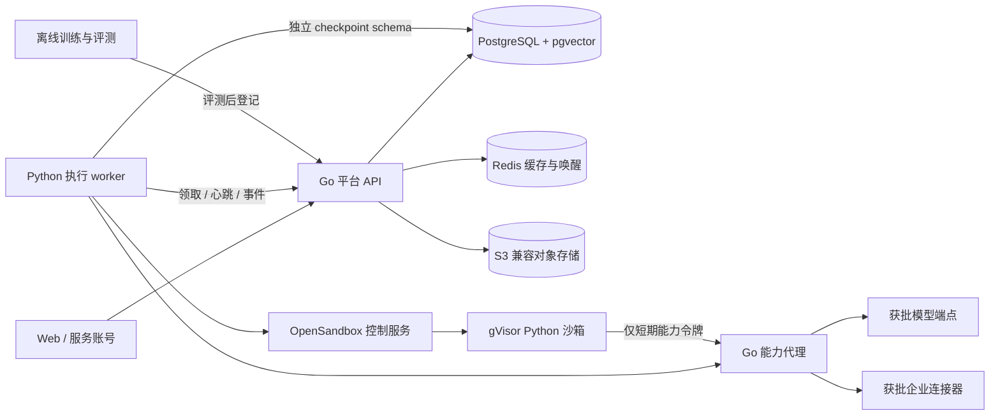

# 系统架构与模块契约

状态：设计与组件策略已确认，尚未实现。候选门禁未通过前不进入正式依赖；库的具体发行版在P0生成lockfile后冻结。

## 1. 部署与职责



图中的 Go 能力代理是同一代码库的内部模块，可先部署在同一 Go 服务；后续按压力拆分。Python worker 不接收公网任务，不自行决定用户权限。脚本执行主机与平台主机分离；平台服务不暴露 Docker socket 给业务容器。

| 模块 | 输入与输出 | 权威与边界 |
|---|---|---|
| identity/policy | 登录主体、角色、资源 ACL → 授权决策 | Go；所有对象读取及动作重新鉴权 |
| catalog/publish | 草稿、测试报告、审阅 → 固定应用版本 | Go；批准只发布已审核内容哈希 |
| requests/router | 用户需求、授权候选 → 澄清/选择/Run | Go 控制状态；模型仅建议路由 |
| execution | Run、job、预算、取消、审批、事件 | Go 维护业务状态与配额，不执行 DAG |
| worker/compiler | 固定 DSL+编译器/依赖版本 → LangGraph | Python；执行内部节点与 checkpoint |
| capabilities | 当前运行授权、参数、审批 → 模型/工具回执 | Go；密钥不进入普通脚本或节点日志 |
| artifacts | 已授权上传、执行产物 → 受控下载引用 | Go；对象存储 key 不是访问凭据 |
| memory/knowledge | 用户确认或组织资料 → 检索结果与引用 | Go 管理数据生命周期；worker 消费最少上下文 |
| evaluation | 固定案例与运行结果 → 不可变报告 | 评测脚本；报告绑定制品和数据哈希 |

## 2. 推荐栈与复用原则

- Go：`net/http` + chi 路由、pgx/sqlc、版本化 SQL 迁移；业务模块先在单体内隔离。不同时引入多个 RPC/任务框架。
- 前端：Vue 3、TypeScript、Vite、Vue Flow；自建节点配置面板及变量选择器。复用画布库，不 fork 其核心实现。
- 执行：Python 3.11 兼容线起步，LangGraph + Postgres checkpointer；DeepAgents 仅用于 Agent 节点。P0 实际依赖解析决定最终 Python 小版本及锁版。
- 持久层：PostgreSQL 为控制状态、事件、任务与权限的唯一权威；pgvector 存嵌入。Redis 仅用于可重建缓存、限流计数和事件唤醒，不承担任务真相。
- 队列：Go 内部 API 领取 PostgreSQL durable job，Python 不读取 Go 私有队列协议。不引入 Asynq/Python 混合消费协议。
- 对象：S3 兼容接口，部署者提供实现；本规格不强制某一对象存储发行版，P0 确认其许可证、签名 URL 和删除行为。
- 脚本：私有 OpenSandbox + gVisor/runsc。依赖构建与正式执行均隔离；执行时不 pip install。
- 观测：平台运行时间线 + OpenTelemetry 脱敏元数据；Prometheus 指标按需接入。Langfuse 等第三方追踪可选，未完成正文策略适配不得默认启用自动全量采集。
- 个人记忆先用平台的明确确认、版本和删除模型；Mem0 不作为首版必需服务。引入记忆抽取库不能替代本产品授权与确认规则。

### v0.2组件细化

完整分层与状态见 [OPEN-SOURCE-REUSE.md](OPEN-SOURCE-REUSE.md)。新增推荐：Element Plus提供基础UI；RAG优先评估LlamaIndex纯分块转换、Docling Native PDF解析；Agent质量优先验证DeepEval本地适配器。Mem0继续作为有门禁的对照后端。Promptfoo为通用质量替代，Ragas为RAG专项，不同时强制部署三套。

对象存储优先部署者已有S3；需要自部署再验证SeaweedFS。LiteLLM/MCP/Collector均为按需候选，不把组件清单当生产服务清单。整平台Coze/Dify/Flowise保持参考身份，避免引入第二个执行引擎/前端/数据权威。具体安装版本需P0锁定，不直接混装研究HEAD。

补充适配边界：`AgentModelAdapter`连接DeepAgents模型接口与平台受控调用，核对工具/流式/取消/用量及隐藏重试；`PublishedAppDelegate`将委派映射为child Run；`Parser/Chunker/MemoryProvider`使用平台ID/来源契约；`PlatformTaskRunner`通过正式API采集统一评测artifact。适配器不是新的通用框架，其目的是维持既有权限、版本和生命周期。

这些是减少额外状态系统的设计选择，不是性能优越性的实测结论。公开接口稳定性优先于框架封装层数量。

## 3. 版本制品

应用版本制品包含：DSL、I/O Schema、能力卡、模型配置版本、脚本环境 digest、子应用版本及其依赖闭包、权限需求、编译器版本、Python lockfile/worker 镜像 digest、状态 schema 版本、测试报告哈希。

运行创建后固定以上内容。草稿变更采用 ETag；审核只允许对同一哈希批准。撤销版本禁止新任务，已有运行按撤销原因决定停止或保留，不能把“当前指针”更新解释为旧运行升级。删除仍被运行引用的制品只做停用，按恢复窗口保留。

草稿调试不伪装成已发布版本：Go 从指定 draft revision 创建不可变 execution_snapshot，Run.kind=debug，执行同一编译/沙箱/预算协议，但只给作者或明确协作者可见，不进入应用路由，不赋予组织共享权限。正式 Run 的 execution_snapshot 则引用已发布版本。二者都不读持续变化的草稿；调试也不跳过权限/隔离硬校验。

云模型供应商可能不提供精确权重 revision；保存请求的 model ID、供应商返回 ID、配置和响应元数据，只承诺配置可追溯，不能声称完全确定性复演。

## 4. 拟建代码目录

```text
apps/web/src/{canvas,chat,catalog,runs,admin}
cmd/{api,maintenance}
internal/{identity,policy,catalog,requests,routing,execution,
          capabilities,artifacts,memory,knowledge,audit}
db/{migrations,queries}
worker/platform_worker/{compiler,nodes,agents,checkpoints,transport}
contracts/{openapi.json,workflow.schema.json,event.schema.json,database.sql}
examples/{sales,branch-approval}
tests/{contracts,integration,faults,security,load,acceptance}
experiments/{routing_sft,datasets,reports}
deploy/{compose,images,policies}
```

当前文档包中的 contracts/examples 是规格输入；上述应用目录尚未生成。

## 5. 不可跨越的边界

1. Go 事务决定用户可见状态；worker 提交带租约的观察/结果，不能直接写业务表。
2. Python checkpoint schema 仅用于图恢复；不作为 ACL、审批或最终结果的真相。
3. 上传文件、检索片段、脚本输出与模型输出均视为不可信数据；不能改写工具白名单和凭据策略。
4. 通用 DeepAgents 文件/终端/网络能力不默认暴露；使用平台包装的工具列表和受控文件后端。P0 核查实际生成的工具清单，不仅检查调用配置。
5. 每个子运行有独立 run ID、执行单元和 checkpoint thread；依赖版本固定，权限与预算来自父调用的约束交集。

## 6. 源码依据与覆盖边界

- Vue Flow `FlowExportObject` 为编辑数据，需独立执行 DSL：[固定源码](https://github.com/bcakmakoglu/vue-flow/blob/17953c329db2d5dc5f5097370cbf5e1173bab520/packages/core/src/types/flow.ts)，详见 [画布研究](research/vue-flow-canvas.md)。
- DeepAgents `create_deep_agent` 及子 Agent 工具构建已静态阅读；不是平台任务/租户隔离：[graph.py](https://github.com/langchain-ai/deepagents/blob/e21ce33d4486899069dda55254e6ec56e874a854/libs/deepagents/deepagents/graph.py)、[subagents.py](https://github.com/langchain-ai/deepagents/blob/e21ce33d4486899069dda55254e6ec56e874a854/libs/deepagents/deepagents/middleware/subagents.py)。
- 该 DeepAgents 源码包为 0.7.32，声明 `langchain>=1.4.7,<2`。不能沿用低于下限的本地旧版本：[依赖声明](https://github.com/langchain-ai/deepagents/blob/e21ce33d4486899069dda55254e6ec56e874a854/libs/deepagents/pyproject.toml)。
- 检查点、恢复与租约约束分别见 [恢复研究](research/workflow-persistence-and-resume.md)、[写入围栏研究](research/execution-fencing-options.md)。尚未验证完整锁版组合或部署性能。
