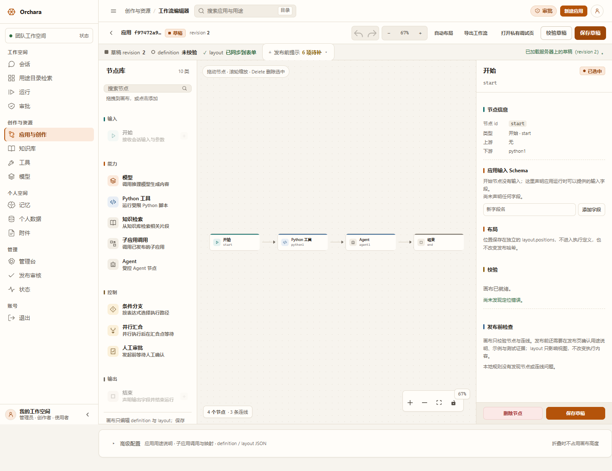
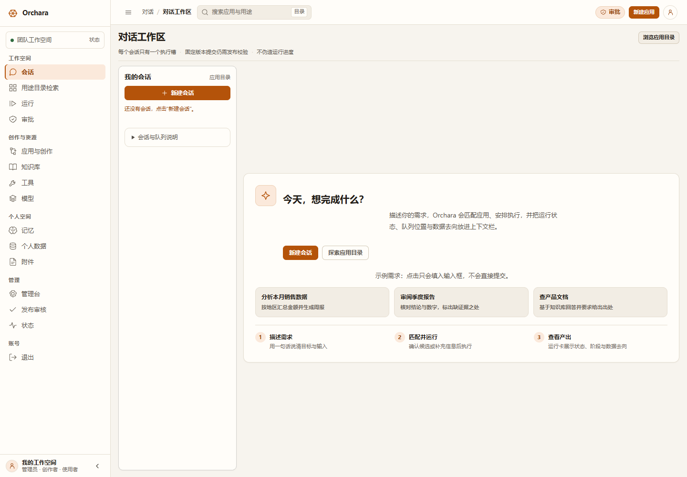
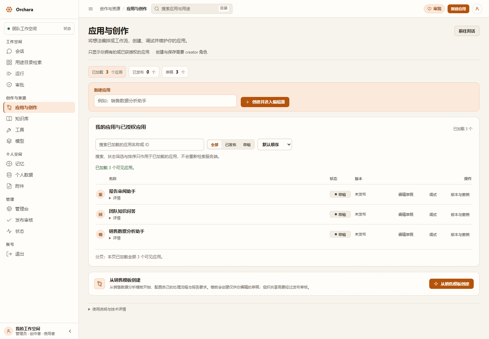
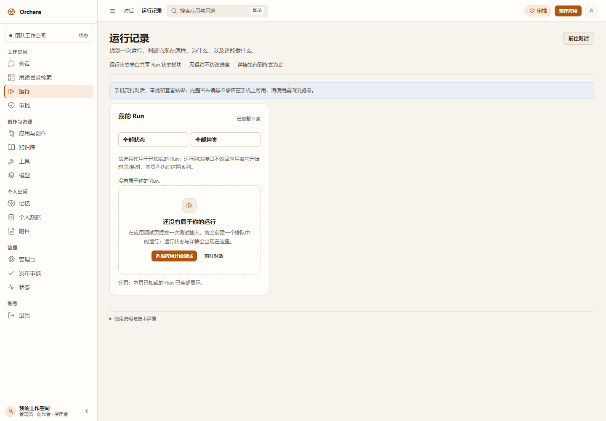

<p align="center">
  
</p>

<h1 align="center">Orchara</h1>

<p align="center">把想法编排成可运行的工作流 · 面向团队的单企业 Agent 应用平台</p>

<p align="center">
  <code>Go 1.27</code> · <code>Vue 3 + Vue Flow</code> · <code>Python 3.12</code> · <code>PostgreSQL 16</code>
  <br>
  22 个产品页面 · 可视化工作流画布 · 运行 / 审批 / 评测 / 发布
</p>

---

## 这是什么

Orchara 让业务团队把「一个想法」变成「一个可运行、可审计、可发布的 Agent 应用」：

| 角色 | 做什么 |
|---|---|
| 业务使用者 | 在**对话工作区**描述需求，Orchara 匹配应用并执行；处理等待确认与审批；查看运行结果与数据去向 |
| 创作者 | 在**工作流画布**上用节点编排流程（模型、工具、知识检索、条件分支、人工审批、子应用），调试、评测、提交发布 |
| 管理员 | 管理用户与角色、邀请、服务账号与 API Key、模型与工具、发布审核与平台状态 |

平台把「草稿 → 校验 → 评测 → 发布审核 → 固定版本运行」做成一条有状态、有证据的链路：草稿冲突不覆盖本地修改，运行状态与租约来自服务端事实，审批显示真实数据目的地，失败原因按服务端错误码呈现。

仓库同时包含**规格包**与**平台实现**：

- 根目录的 `HANDOFF.md`、`ARCHITECTURE.md`、`WORKFLOW-SPEC.md` 等是只读规格与决策记录；
- `product/` 是 Go + Vue + Python 的实际实现、测试、部署与验收证据。

## 界面

全部页面使用统一的暖色专业工具风设计系统（共享令牌、组件与外壳），支持桌面与手机：

| | |
|---|---|
| **对话工作区**<br>会话、消息流、运行上下文、内联失败卡、附件与跨应用交接<br> | **工作流编辑器**<br>节点库—画布—属性面板，整页工作台，校验错误可定位<br> |
| **应用与创作**<br>状态、版本、负责人、最近活动，内部 ID 按需展开<br> | **运行与审批**<br>列表 + 详情，租约、快照、时间线、数据去向与决策<br> |

更多截图：[22 页桌面总览](product/reports/ui-polish/contact-sheet.png) · [22 页手机总览](product/reports/ui-polish/contact-sheet-mobile.png) · [全部 53 张](product/reports/ui-polish/screenshots/)。

## 现在能跑什么

本机可用 `dev-stub` profile 启动完整开发栈（真实 PostgreSQL、真实编译的 Go API、真实 HTTP 与浏览器）：

- 22 个页面：登录/激活、平台状态、对话、应用目录、我的应用、编辑器、调试、评测、发布、审核、版本、运行、审批、文件、知识库、记忆、个人数据、工具、模型、管理台；
- Vue Flow 画布：节点库、连线、选中态、属性面板、校验与草稿冲突处理，构建产物可复现；
- 身份与权限：邀请/激活/登录/登出、CSRF、默认拒绝 ACL、角色可见性、服务账号与可撤销 API Key；
- 运行链路：排队与租约、SSE 事件流、取消/恢复、终态交接、审批与数据去向。

**边界要说清**：`dev-stub` 只验证产品链路与状态语义，**不代表**真实供应商模型质量、正式隔离或生产部署；平台还不是完整 v1（详见 [限制](#状态与限制)）。

## 架构

```
浏览器（22 页 + Vue Flow 画布）
        │  HTTP（同源 Cookie 会话 + CSRF）
        ▼
Go API ──────────────► PostgreSQL（状态权威、队列与租约）
  │  静态页面/资产            ▲
  │  mTLS 内部监听            │ 轮询/领取
  ▼                          │
maintenance / supervisor ────┘
  └─► Python worker（受控工具、模型调用、评测）
```

- **Go**：`cmd/api`（页面 + API）、`cmd/admin`（迁移/引导）、`cmd/maintenance`（后台任务双池）、`cmd/supervisor`（沙箱执行）；
- **Web**：22 个独立 HTML 页面 + 共享设计系统（`apps/web/src/assets/`）+ Vue Flow 画布（`apps/web/canvas/src/`）；
- **Python**：工具与模型调用、评测 runner、探针与实验；
- **数据**：PostgreSQL 迁移链 + 对象存储 + 契约快照（`contracts/`）。

## 快速开始

前置：Go 1.27、Node 24、Python 3.12（含 Playwright 与 Chrome，用于浏览器验收）、PostgreSQL 16 客户端与服务端。
工具链可放在仓库外，用 `ORCHARA_TOOLCHAINS` 覆盖。

```powershell
cd E:\Orchara\product

# 1) 本地开发库口令（git-ignored，不要提交）
#    product/.env.local 内容：ORCHARA_PG_PASSWORD=<你的本地口令>

# 2) 启动隔离开发库（项目固定 55432，不占用本机 5432）
python -X utf8 tools\pg_dev.py init

# 3) 启动完整开发栈：迁移 → 建管理员 → API → maintenance
$env:ORCHARA_DEV_ADMIN_PASSWORD = "<至少 12 位的本地管理员口令>"
python -X utf8 deploy\dev\bringup.py up --fresh
# 终端会打印实际 URL、内部 mTLS 端口、admin 登录名与日志目录

# 4) 浏览器打开打印出的 URL；`/` 会 303 跳到 /chat，登录后进入对话工作区
```

停止：`Ctrl-C` 同时停止 API 与 maintenance，再 `python tools\pg_dev.py stop`。
开发证书过期时删除 `product/.devstack/certs` 后重新启动即可。详见 [deploy/dev/README.md](product/deploy/dev/README.md)。

### 测试与验收

```powershell
cd product
python -m pytest tests -q                  # 产品测试（部分需 Go 与开发库）
go test ./...                              # Go 单元测试
python -X utf8 tools\verify_frontend.py --out reports\ui-polish   # 真实 Chrome 全站验收
```

前端验收会自建隔离数据库、启动真实 DevStack、跑真实 Chrome，覆盖 22 页桌面 + 22 页手机 + 4 页横屏、
唯一主标题、逐导航地标 `aria-current`、44px 触摸目标、对比度与真实登录/退出。

## 验证与证据

本轮前端精细化（[#164](https://github.com/xiaolin624/Orchara/issues/164)）的实际结果：

| 项目 | 结果 |
|---|---|
| 真实浏览器 | 22 桌面 + 22 手机 + 4 横屏 + 5 交互态，53 张截图，`page_errors=[]` |
| 对比度 | 12 对全部 ≥4.5:1（正文 16.49、次要 7.71、主按钮 5.02） |
| 页面回归 | 5 组执行、去重 642 个用例全部通过（0 failed / 0 skipped） |
| 画布 | `npm.cmd run build` 成功，产物可由源码逐字节重建 |
| 其他 | `go test ./internal/api ./cmd/api` ok；`sync_spec --check` no drift；16/16 JS 语法检查 |

证据与截图：[product/reports/ui-polish/](product/reports/ui-polish/README.md)（上一轮：[ui-redesign](product/reports/ui-redesign/README.md)）。
实现进度以 [product/PROGRESS.md](product/PROGRESS.md) 为权威。

## 规格与文档

先读 [HANDOFF.md](HANDOFF.md)，再看 [IMPLEMENTATION-ORDER.md](IMPLEMENTATION-ORDER.md) 与任务图。

| 主题 | 文档 |
|---|---|
| 接手与实施顺序 | [HANDOFF.md](HANDOFF.md) · [BOOTSTRAP.md](BOOTSTRAP.md) · [IMPLEMENTATION-ORDER.md](IMPLEMENTATION-ORDER.md) · [DEVELOPMENT-PLAN.md](DEVELOPMENT-PLAN.md) |
| 产品与体验 | [PRODUCT.md](PRODUCT.md) · [GLOSSARY.md](GLOSSARY.md) · [UX.md](UX.md) |
| 架构与复用 | [ARCHITECTURE.md](ARCHITECTURE.md) · [OPEN-SOURCE-REUSE.md](OPEN-SOURCE-REUSE.md) · [COMPONENTS-AND-CLONE.md](COMPONENTS-AND-CLONE.md) |
| 工作流与执行 | [WORKFLOW-SPEC.md](WORKFLOW-SPEC.md) · [EXECUTION.md](EXECUTION.md) · [STATE-MACHINES.md](STATE-MACHINES.md) · [COMPILER-CONTRACT.md](COMPILER-CONTRACT.md) |
| 数据与安全 | [DATA-MODEL.md](DATA-MODEL.md) · [API.md](API.md) · [SECURITY.md](SECURITY.md) · [DATA-POLICY.md](DATA-POLICY.md) |
| 评测与运维 | [EVALUATION.md](EVALUATION.md) · [TESTING-AND-DATASETS.md](TESTING-AND-DATASETS.md) · [OPERATIONS.md](OPERATIONS.md) |
| 本轮前端精细化 | [docs/frontend-polish.md](docs/frontend-polish.md) · [docs/frontend-redesign.md](docs/frontend-redesign.md) |

机器可读契约在 [contracts/](contracts)：SQL 基线、DSL JSON Schema、OpenAPI、事件 Schema；合法/非法样例在 [examples/](examples/)。
静态一致性检查：`python tools/validate_contracts.py`（不启动平台，也不证明运行时行为）。

**证据等级**：已确认需求来自 [DESIGN-SESSION.md](DESIGN-SESSION.md) Q1–Q46；推荐设计（表结构、内部协议、默认参数）是实施基线；
源码事实见 [research/](research) 的固定 commit；待验证项（外部服务行为、SLO、容量、模型效果）不得改写为已通过。

## 状态与限制

| 项目 | 状态 |
|---|---|
| 本机 `dev-stub` 开发栈 | **可启动、已验收**（真实 PG / Go / HTTP / Chrome） |
| 真实供应商模型、embedding | `blocked` / `not_run`：无已获批端点凭据 |
| 生产隔离（独立 Linux + runsc/gVisor） | `blocked`：仅在 WSL2 完成隔离验收 |
| 容器化部署、S3、备份恢复演练 | `not_run`：当前是「多进程 + 本地 PostgreSQL」 |
| 浏览器覆盖 | 仅 Chrome headless；未验证 Safari/Firefox、真机与屏幕阅读器 |
| 完整 v1 | 未完成：评测执行器、发布门禁、RAG/记忆、真实外部写入等 epic 仍在推进 |

平台**不是**已上线的企业系统，也不把规格确认、stub 结果或静态校验写成生产验收。阻塞与解除条件的权威记录见
[product/README.md](product/README.md#已登记阻塞d00t001-实测--后续补充) 与 [OPERATIONS.md](OPERATIONS.md)。

## 目录

```
.
├─ HANDOFF.md 等           规格、决策与交接文档（只读来源）
├─ docs/                   代理约定、前端设计与领域文档
├─ contracts/              SQL / OpenAPI / JSON Schema / 事件契约
├─ examples/               合法与非法工作流样例
├─ product/                平台实现
│  ├─ apps/web/            22 个页面与 Vue Flow 画布
│  ├─ cmd/ internal/       Go 服务与领域代码
│  ├─ db/                  迁移链
│  ├─ deploy/dev/          本地开发栈（bringup / pg_dev）
│  ├─ tests/               产品测试与页面回归
│  └─ reports/             验收证据、截图与实验报告
└─ research/               组件调研与来源固定记录
```

---

<p align="center"><sub>本仓库的「通过」只指对应范围内的实际执行结果；未运行项一律记为 <code>not_run</code>。</sub></p>
